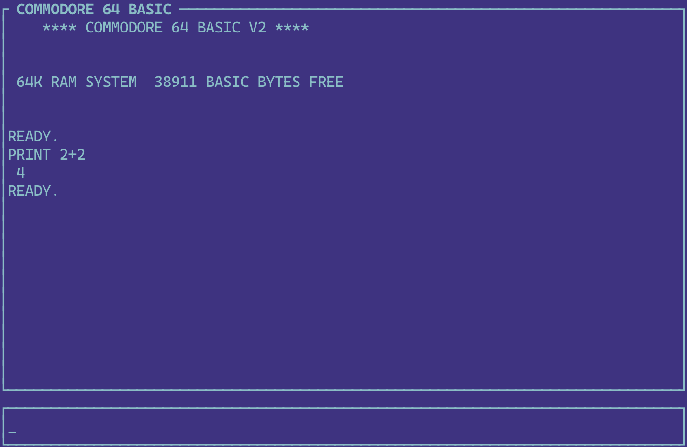

# Nano-BASIC: Commodore 64 BASIC Interpreter

[](https://github.com/aovestdipaperino/nano-basic/stargazers)



A Commodore 64 BASIC V2 interpreter with an authentic 40x25 character TUI that resembles the original C64 screen.

## ✨ Features

- **Authentic C64 TUI**: 40x25 character display with classic blue background and light blue text
- **Full Expression Support**: Math operators (+, -, *, /, ^), comparisons (=, <>, <, >, <=, >=), logical operators (AND, OR, NOT)
- **Control Flow**: IF/THEN, GOTO, GOSUB/RETURN, FOR/NEXT loops with STEP
- **Math Functions**: ABS, INT, SGN, SQR, SIN, COS, TAN, ATN, LOG, EXP, RND
- **String Functions**: LEFT$, RIGHT$, MID$, LEN, ASC, CHR$, VAL, STR$
- **Tokenized .PRG Format**: Read and write C64 BASIC programs in native tokenized format
- **Variables**: Numeric and string variables with automatic type handling
- **REPL Interface**: Interactive command-line experience like the real C64

## 🚀 Quick Start

### Building

```bash
cargo build --release
```

### Running

```bash
cargo run
```

Type `QUIT` (or `EXIT` or `BYE`) to exit, or press `Ctrl+C`.

## 📖 Usage

### Immediate Commands

Execute these commands directly at the READY prompt:

| Command | Description | Example |
|---------|-------------|---------|
| `LIST` | Display the current program | `LIST` |
| `RUN` | Execute the program in memory | `RUN` |
| `NEW` | Clear program memory | `NEW` |
| `CLR` | Clear variables only | `CLR` |
| `LOAD "file"` | Load a .PRG file | `LOAD "SOCCER"` |
| `SAVE "file"` | Save program to .PRG file | `SAVE "MYPRG"` |
| `PRINT expr` | Print text or evaluate expression | `PRINT 2+2` |
| `?` | Shorthand for PRINT | `? "HELLO"` |
| `QUIT` | Exit the interpreter | `QUIT` |

### Programming

Type a line number followed by code to add it to the program:

```basic
10 PRINT "HELLO, WORLD!"
20 FOR I=1 TO 10
30 PRINT I
40 NEXT I
50 END
```

Type just a line number to delete that line:

```basic
20
```

### Variables

```basic
A=10
B=20
PRINT A+B
NAME$="COMMODORE"
PRINT NAME$
```

### Control Flow

**IF/THEN:**
```basic
10 IF X>5 THEN PRINT "BIG"
20 IF X<5 THEN GOTO 100
```

**FOR/NEXT Loops:**
```basic
10 FOR I=1 TO 10
20 PRINT I*I
30 NEXT I
```

**Subroutines:**
```basic
10 GOSUB 1000
20 END
1000 PRINT "SUBROUTINE"
1010 RETURN
```

## 🎮 Example Session

```
    **** COMMODORE 64 BASIC V2 ****

 64K RAM SYSTEM  38911 BASIC BYTES FREE

READY.
10 FOR I=1 TO 5
20 PRINT I;" SQUARED = ";I*I
30 NEXT I
RUN
 1  SQUARED =  1
 2  SQUARED =  4
 3  SQUARED =  9
 4  SQUARED =  16
 5  SQUARED =  25
READY.
SAVE "SQUARES"
SAVING SQUARES
READY.
QUIT
```

## 📝 What's Implemented

### ✅ Commands (60+ features)
- **Program Control**: LET, GOTO, IF/THEN, GOSUB, RETURN, FOR, NEXT, STEP, END, STOP
- **Program Management**: LIST, RUN, NEW, CLR, LOAD, SAVE
- **Output**: PRINT, ? (shorthand)
- **Comments**: REM

### ✅ Operators
- **Arithmetic**: `+`, `-`, `*`, `/`, `^` (exponentiation)
- **Comparison**: `=`, `<>`, `<`, `>`, `<=`, `>=`
- **Logical**: `AND`, `OR`, `NOT` (bitwise like C64)
- **Parentheses** for grouping expressions

### ✅ Math Functions
`ABS`, `INT`, `SGN`, `SQR`, `SIN`, `COS`, `TAN`, `ATN`, `LOG`, `EXP`, `RND`

### ✅ String Functions
`LEFT$`, `RIGHT$`, `MID$`, `LEN`, `ASC`, `CHR$`, `VAL`, `STR$`

### ✅ Features
- Proper operator precedence
- String concatenation with `+`
- Uninitialized variables default to 0 or ""
- C64-style boolean values (-1 for true, 0 for false)

## 🎯 TODO (Future Enhancements)

- [ ] INPUT command (user input during program execution)
- [ ] READ/DATA statements
- [ ] DIM arrays (single and multi-dimensional)
- [ ] ON...GOTO/GOSUB computed branches
- [ ] PRINT formatting (semicolon/comma separators)
- [ ] Multiple statements per line with `:` separator
- [ ] File I/O (OPEN, CLOSE, INPUT#, PRINT#)
- [ ] POKE/PEEK/SYS (memory operations)
- [ ] DEF FN (user-defined functions)

## 📦 PRG File Format

.PRG files use the authentic Commodore 64 tokenized BASIC format:

- **Bytes 0-1**: Load address (0x0801 for BASIC programs, little-endian)
- **Each line**: [next_addr_lo, next_addr_hi, line_num_lo, line_num_hi, tokens..., 0x00]
- **End marker**: [0x00, 0x00]

Generate test programs:

```bash
python3 create_prg.py        # Creates test.prg
python3 create_soccer.py     # Creates soccer.prg
python3 create_math_demo.py  # Creates math.prg
```

## 🔧 Technical Details

- **Language**: Rust (edition 2024)
- **TUI Framework**: ratatui 0.29 + crossterm 0.28
- **Binary Size**: ~1MB (optimized release build)
- **C64 Colors**: RGB values matching original palette
  - Background: `#403285` (C64 blue)
  - Text: `#7ABFC7` (C64 light blue)
- **Token Specification**: C64 BASIC V2 (tokens 0x80-0xD1)

## 📚 Documentation

- [USAGE.md](USAGE.md) - Detailed user guide with examples
- [EXAMPLES.md](EXAMPLES.md) - 20 example programs to try
- [COMMANDS.md](COMMANDS.md) - Complete C64 BASIC reference
- [STATUS.md](STATUS.md) - Feature matrix and roadmap
- [CHANGELOG.md](CHANGELOG.md) - Version history

## 🐛 Known Limitations

- Output from RUN appears all at once when program completes (not line-by-line)
  - This is a TUI architecture limitation
  - All output IS generated correctly, just batched for display
- Infinite loops require Ctrl+C to interrupt
- No INPUT command yet (can't get user input during program execution)

## 🤝 Contributing

Contributions welcome! This is a learning project implementing a C64 BASIC interpreter.

## 📄 License

MIT

---

**Made with ❤️ for Commodore 64 enthusiasts**
